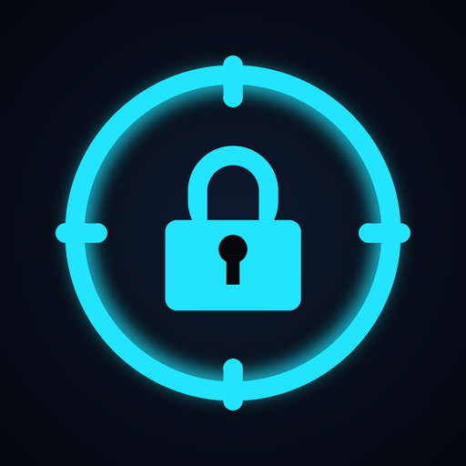

# PCL (Project Chronos Lock) Privacy Policy

{: width="96"}

Last updated: November 2026. Developer: PCL Studios ([GitHub](https://github.com/PCLStudios), [@pclglobal](https://x.com/pclglobal)).

## What PCL is
A voice assistant app for Android. It has no accounts and no PCL server. We do not collect your name, email or location.

## Microphone
PCL uses the microphone only while its listening service runs (shown by a notification).
- **Music-safe mic (optional download):** speech is recognised on your phone, offline. Audio does not leave the device.
- **Android / Google speech recogniser:** used for whisper mode, the chatbot, and when the offline model isn't installed. Audio is handled by Google under Google's privacy policy.

## Chatbot
What you say to the chatbot is sent as text to the A.I. provider you choose (for example Groq, Google or OpenRouter) using your own API key. Their policies apply. Your key is stored only on your phone and is never included in backups.

## Stored on your phone
Settings, names, theme, widgets, programs, notes and your API key stay in PCL's private storage.

## Ads
PCL shows ads through Google AdMob (a small banner and optional rewarded ads). AdMob may use your device's advertising ID to serve and measure ads. Where required (EU/UK and others) you are asked for consent first. A 24 hour Power Pass hides banners. See [Google's ad policy](https://policies.google.com/technologies/ads).

## Donations
Donations are handled by Buy Me a Coffee or sent to the public crypto addresses in the About page. PCL does not process payments.

## Children
PCL is not directed to children under 13.

## Contact
Open an issue at github.com/PCLStudios or message @pclglobal on X.
